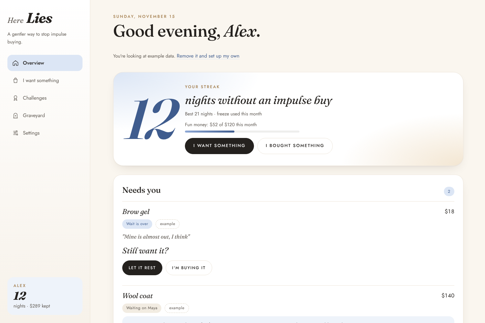
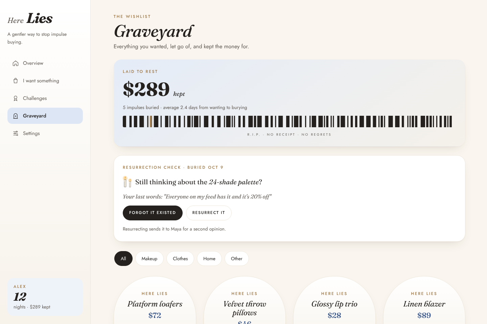
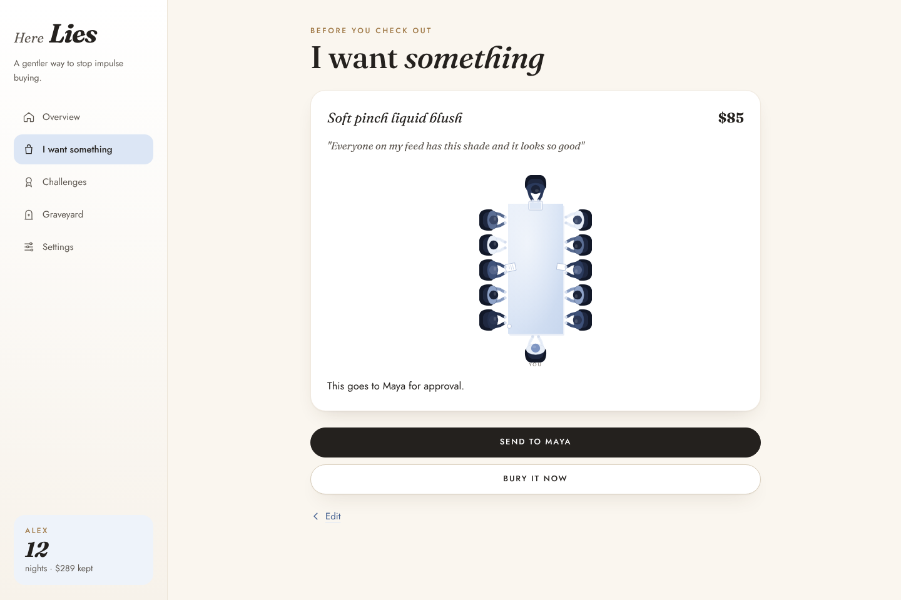
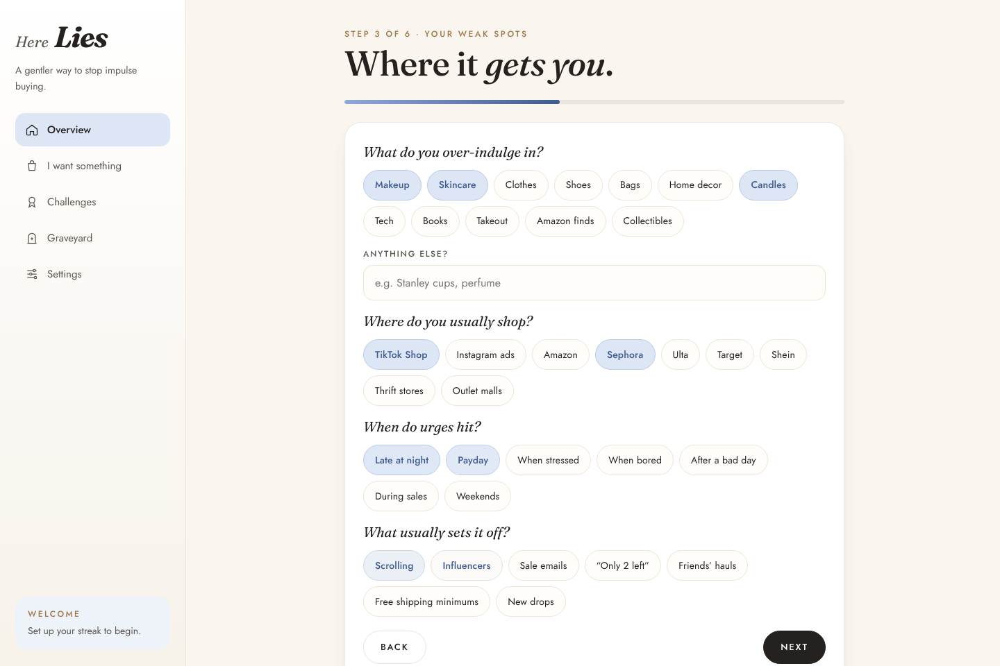
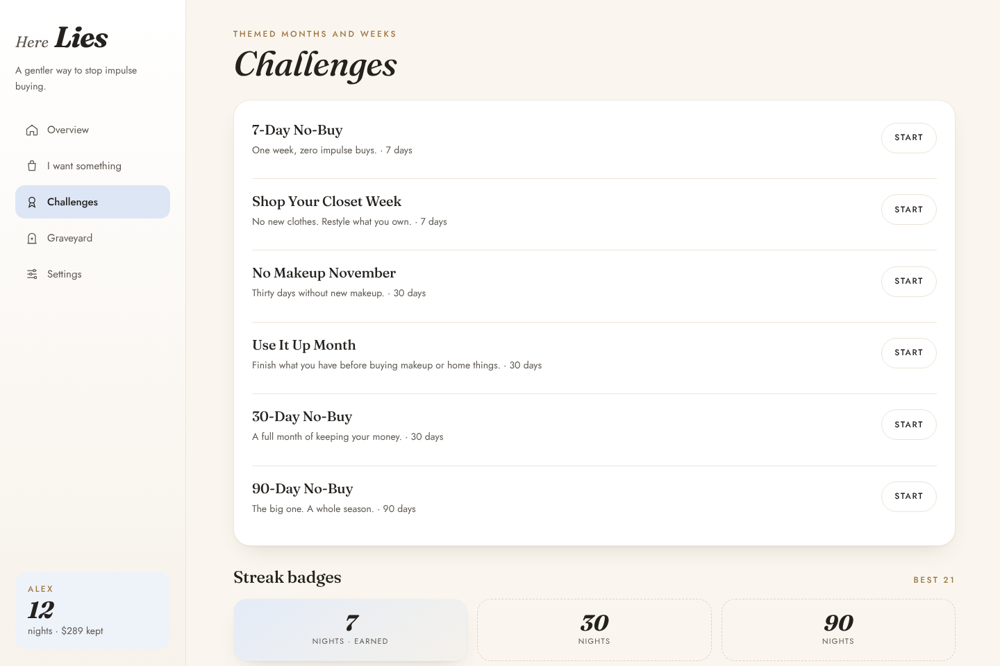
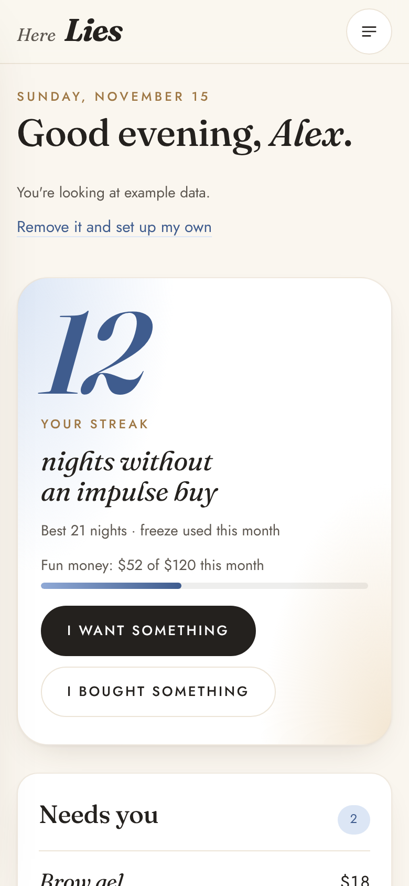
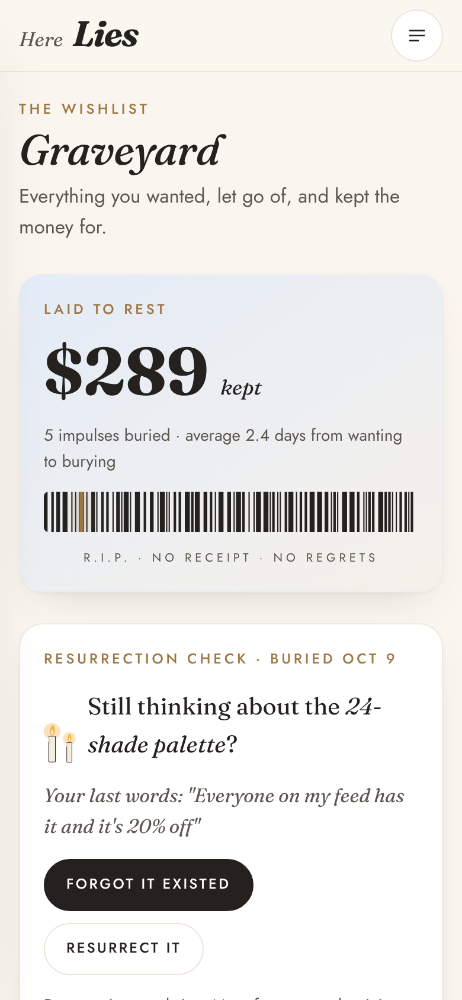
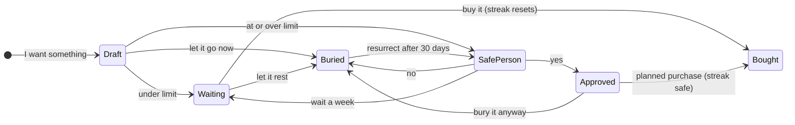

<p align="center">
  
</p>

<h1 align="center">Here Lies</h1>

<p align="center"><em>Every impulse buy you talked yourself out of.</em></p>

<p align="center">
  <a href="https://serene4444.github.io/here-lies/"><strong>Live demo</strong></a> ·
  <a href="#features">Features</a> ·
  <a href="#how-it-works">How it works</a> ·
  <a href="#getting-started">Getting started</a>
</p>

<p align="center">
  <a href="https://github.com/serene4444/here-lies/actions/workflows/pages.yml"></a>
  
  
  
  
  <a href="LICENSE"></a>
</p>

<p align="center">
  
</p>

## About

Impulse shopping rarely sticks to one thing. It moves from makeup to clothes to home decor, but the urge behind it stays the same. Most budgeting apps track categories after the money is gone. **Here Lies tracks the urge, before checkout.**

When you want something, you log it here instead of buying it. You write down why you want it, and it goes to a waiting room or to your safe person for approval. If you let it go, it's laid to rest in the **Wishlist Graveyard** and the money you kept counts toward a reward you choose.

## Features

**Slow the purchase down**
- **I want something:** log the item, price, category and a required reason before anything moves forward.
- **Waiting room:** items under your limit wait 24, 48 or 72 hours, with an extra day for your self-reported weak spots.
- **Safe person:** items over your limit generate a personalized "check me" message for your accountability buddy, then you record their yes, no or wait-a-week.
- **Risky-hour warnings:** if you said late nights are when it gets you, the form tells you when it's late.

**AI assistance** (when hosted inside Claude)
- **"Do I need this?" coach:** asks up to three honest questions, then gives a verdict. It's grounded in your profile, budget, the time of day and the tone you chose.
- **Screenshot reader:** upload a screenshot from TikTok, Instagram or a store, and it extracts the product, price and category as structured JSON.

**Stay motivated**
- **Streaks** with one freeze per month and a **monthly streak calendar** that shows clean runs, items let go, slips and money kept.
- **Reward fund:** money kept adds up toward a planned, guilt-free purchase that unlocks at 30 nights.
- **Fun-money budget:** tracks this month's spending against your limit.
- **Themed challenges:** No Makeup November, Shop Your Closet Week, Use It Up Month, and 7, 30 and 90-day no-buys, with badges.

**Reflect**
- **Wishlist Graveyard:** every item you let go of as a headstone with its price, dates and "last words."
- **Resurrection check:** 30 days later it asks if you still want it. Usually you've forgotten it existed.
- **Create your profile:** a six-step onboarding covering your why, weak spots, triggers, budget, safe person and coaching style, ending in a profile card.

## Screenshots

| Wishlist Graveyard | Asking your safe person |
| :---: | :---: |
|  |  |
| **Create your profile** | **Themed challenges** |
|  |  |

<p align="center">
  
  &nbsp;&nbsp;
  
</p>

## How it works

### Architecture

Here Lies is a dependency-free single-page app: one HTML file, one stylesheet and one script, with no framework and no build step.

| Concern | Approach |
| --- | --- |
| Routing | Hash routes (`#home`, `#ask`, `#challenges`, `#graveyard`, `#setup`) with a `hashchange` listener |
| Rendering | Each view is a pure function of state that returns an HTML string, re-rendered on every change |
| Events | One delegated `click` and one `submit` listener dispatch to `actions` and `forms` tables via `data-act` / `data-form` attributes |
| State | A single state object, normalized on load so older saved data stays compatible |
| Persistence | A storage adapter: the per-user database when hosted in Claude, `localStorage` everywhere else, with debounced saves |
| Security | All user text is escaped before it reaches the DOM |

### Purchase lifecycle



### AI integration

Both AI features call the host's model through a runtime capability and **degrade gracefully**: if the capability isn't available, isn't granted or is rate limited, the feature hides itself or shows a specific message and the rest of the app keeps working.

- **Coach:** a multi-turn conversation with a system prompt built from the user's profile (weak spots, triggers, risky times, budget, savings goal, local time) and their chosen tone. It's capped at three questions and ends with a parseable `VERDICT:` line. Responses stream in token by token and can be stopped mid-answer.
- **Screenshot reader:** sends the image with a strict JSON schema (`name`, `price`, `category`, `store`). The result is validated before it fills the form, and anything the user already typed is kept.

### Design

Soft luxury: cream paper, powder blue and champagne gold, with Fraunces for display type and Jost for body text. It's light-only by design, uses a sidebar dashboard on desktop and a slide-out menu on phones, and respects `prefers-reduced-motion`. All illustrations are hand-written inline SVG.

## Getting started

No install is needed. Clone the repo and open `index.html`, or serve the folder:

```bash
git clone https://github.com/serene4444/here-lies.git
cd here-lies
python3 -m http.server 8000
```

Then visit <http://localhost:8000> and choose **"Fill it with example data"** to explore with a sample profile.

> **Note:** outside Claude, data is saved to your browser's `localStorage`, and the AI coach and screenshot reader are hidden.

## Project structure

```
here-lies/
├── index.html              # Markup and app shell
├── css/
│   └── styles.css          # Design tokens, layout and components
├── js/
│   └── app.js              # State, storage, routing, views and AI features
├── assets/
│   └── favicon.svg
├── docs/
│   └── screenshots/        # Images used in this README
└── .github/workflows/
    └── pages.yml           # Syntax check, then deploy to GitHub Pages
```

## Deployment

Every push to `main` runs a syntax check and deploys the site to GitHub Pages. To turn it on for a fork, go to **Settings → Pages** and set the source to **GitHub Actions**.

## Roadmap

- [ ] Serverless endpoint for the Claude API so the coach and screenshot reader work on the public site
- [ ] Real buddy accounts with an approval inbox and notifications
- [ ] Insights page: when urges hit, top triggers, let-go rate
- [ ] AI-written monthly recap
- [ ] "You already own this" inventory
- [ ] Installable PWA with waiting-room reminders

## License

Released under the [MIT License](LICENSE).

## Author

**Serene Plummer** · Computer Science, University of North Texas
[GitHub](https://github.com/serene4444) · [LinkedIn](https://linkedin.com/in/serenep)
